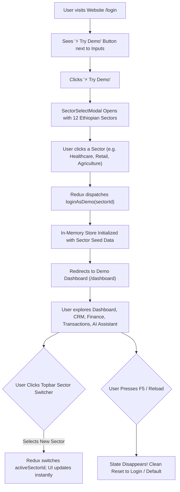

# Master Specification & Prompt: Building an In-Memory Redux Toolkit Multi-Sector Demo of Beyond ERP

> **Instructions for the Code Agent**:
> You are tasked with integrating an **interactive, fully functional, 100% client-side MULTI-SECTOR DEMO of Beyond ERP** into an existing web application.
> 
> **GROUND TRUTH REFERENCE REPOSITORY**:
> The UI, design system, layout structure, color tokens, and business logic of this demo are modeled directly after the **`beyond-erp-frontend`** root frontend repository (package name: `"beyond-erp-frontend"`), **NOT** `beyond-erp-main`. All styling, component structures, navigation bars, modals, and themes must match `beyond-erp-frontend` with 100% fidelity.
>
> **PREREQUISITE - STEP 0: PURGE & REMOVE ANY EXISTING DEMO FILES**:
> Before implementing any code, **inspect the target project and delete/remove any existing, partial, legacy, or outdated demo code, mock demo routes, demo stores, or placeholder components** (such as old `demo/` folders, `mockDemo.ts`, or previous demo pages). Ensure a clean workspace so there are no duplicate routes, naming collisions, or stale states.
>
> **CRITICAL ARCHITECTURAL CONSTRAINTS**:
> 1. **ZERO BACKEND / ZERO API / ZERO DATABASE**: The demo must NOT require any backend server, Express API, Prisma, PostgreSQL, Supabase, Firebase, or external network requests.
> 2. **STATE DRIVEN EXCLUSIVELY BY REDUX TOOLKIT**: All business logic, CRUD operations, transactions, staff, invoicing, approvals, permissions, CRM deals, settings, and sector data must be managed in-memory using **Redux Toolkit (`@reduxjs/toolkit` + `react-redux`)**.
> 3. **DISAPPEAR ON PAGE RELOAD (TRANSIENT IN-MEMORY STATE)**: When the user refreshes or reloads the browser (`F5` or Cmd+R), **all modified state must cleanly reset / disappear** back to the initial pristine state (or back to the unauthenticated login screen). Do NOT persist transactional edits or demo session data to `localStorage` or `IndexedDB`.
> 4. **INTERACTIVE SECTOR SELECTION ON "TRY DEMO"**:
>    - On the website's login page, right next to the credentials input fields or login action button, provide a prominent, high-converting **"⚡ Try Demo"** button.
>    - Clicking "⚡ Try Demo" opens the **Sector Selection Modal (`SectorSelectModal`)** featuring all **12 authentic Ethiopian Sectors**.
>    - Clicking any sector card instantly provisions a dedicated, realistic company workspace tailored specifically to that sector and navigates directly to `/dashboard`.
> 5. **DYNAMIC IN-APP SECTOR SWITCHING**:
>    - Inside the demo ERP workspace, the Topbar and Sidebar include a persistent **Sector Switcher Pill / Dropdown** (e.g., `[ 🏥 Healthcare: Selam Hospital ▾ ]`).
>    - The user can switch to ANY of the 12 sectors on the fly at any time. Switching dynamically adapts the company name, Ethiopian TIN, sidebar sub-modules, sector KPIs, domain records, CRM deals, and task boards instantly without page reload.
> 6. **100% IDENTICAL UI & RESPONSIVE FIDELITY**:
>    - Desktop (`min-width: 900px`): Full dashboard grid layout, collapsible sidebar, comprehensive topbar with greeting, live date, sector switcher, sync indicator, user chip, and AI Assistant button.
>    - Mobile/Tablet: Phone-frame wrapper (`.phone-frame`), floating header, and fixed bottom navigation bar (`BottomNav`).
>    - Theme: Full Light and Dark mode support via `[data-theme="dark"]` CSS variables.
>    - Modules: All 8 core views (Dashboard, Transactions, Employees, Finance with 4 tabs, CRM, Reports, Admin, Settings) + Dynamic Sector Modules (`/m/[module]`) + Sector Overview (`/sectors/[id]`) + AI Assistant Drawer (`AIAssistantSidebar`) + All 11 Modals.

---

## Table of Contents
1. [Target User Journey & Experience](#1-target-user-journey--experience)
2. [Step 0: Purging Existing Demo Code](#2-step-0-purging-existing-demo-code)
3. [Login Page "⚡ Try Demo" Button & Sector Selector Modal](#3-login-page--try-demo-button--sector-selector-modal)
4. [The 12 Ethiopian Sectors Blueprint & Seed Data](#4-the-12-ethiopian-sectors-blueprint--seed-data)
5. [Redux Toolkit Store Architecture & Slice Specifications](#5-redux-toolkit-store-architecture--slice-specifications)
6. [Design System, Themes & Responsive Phone-Frame Specs](#6-design-system-themes--responsive-phone-frame-specs)
7. [ERP Shell Layout, Topbar with Sector Switcher & Navigation](#7-erp-shell-layout-topbar-with-sector-switcher--navigation)
8. [Detailed Specifications for Core Views & CRM Module](#8-detailed-specifications-for-core-views--crm-module)
9. [Detailed Specifications for All 11 Modals + AI Assistant Drawer](#9-detailed-specifications-for-all-11-modals--ai-assistant-drawer)
10. [Target Code Agent Step-by-Step Implementation Guide](#10-target-code-agent-step-by-step-implementation-guide)

---

## 1. Target User Journey & Experience



1. **Discovery on Login**: A user arrives at the website's login page (`/login`). Beside or directly below the login credentials input fields, they find an eye-catching button: **"⚡ Try Demo"**.
2. **Interactive 12-Sector Selection**: Clicking the button opens the `SectorSelectModal`. The modal presents 12 cards representing Ethiopia's major economic sectors, each with its authentic icon, brand color, sample company name (e.g., *Merkato Trade PLC*, *Selam General Hospital*, *Hawassa Textile Industries*), and primary ERP modules.
3. **Instant Workspace Provisioning**: Selecting a sector dispatches `loginAsDemo({ sectorId })` in Redux, establishing the authenticated demo session and seeding domain records, staff, transactions, and CRM deals. The browser immediately routes to `/dashboard`.
4. **Dynamic On-the-Fly Sector Switching**: Inside the ERP workspace, the Topbar and Sidebar display the current sector pill (e.g., `[ 🏥 Healthcare: Selam Hospital ▾ ]`). Clicking it triggers the sector switcher dropdown or modal, allowing the user to switch to any other sector instantaneously without re-logging or losing their active session context.
5. **Transient Ephemeral State (Disappear on Reload)**: Because the entire state resides in Redux Toolkit memory without `localStorage` synchronization for transactional data, refreshing the browser (`F5`) completely resets the demo to pristine unauthenticated state.

---

## 2. Step 0: Purging Existing Demo Code

Before creating new components, the receiving code agent **MUST** perform a cleanup pass in the target repository:
1. Search for existing demo directories such as:
   - `src/demo/` or `src/features/demo/`
   - `src/app/demo/` or `src/pages/demo/`
   - `src/components/demo/`
   - Files named `mockData.ts`, `demoStore.ts`, `demoData.ts`, or legacy demo modals.
2. Remove or deprecate any obsolete demo mock files that might collide with the new Redux store structure.
3. Clean up any broken references or placeholder demo buttons on the login page.
4. Verify that the target project builds cleanly before proceeding to install Redux Toolkit and scaffolding the new demo.

---

## 3. Login Page "⚡ Try Demo" Button & Sector Selector Modal

### 3.1 UI Placement on Login Page
Next to or directly below the login input fields (e.g. adjacent to the "Sign In" button or underneath the form inputs), add the demo action:

```tsx
{/* Demo Launcher on Login Page */}
<div className="mt-4 pt-4 border-t border-slate-200 dark:border-slate-800 flex flex-col gap-2">
  <div className="flex items-center justify-between text-xs text-slate-500 dark:text-slate-400">
    <span>Want to explore without credentials?</span>
    <span className="font-semibold text-blue-600 dark:text-blue-400">Instant Access</span>
  </div>
  <button
    type="button"
    onClick={() => setSectorModalOpen(true)}
    className="w-full flex items-center justify-center gap-2 py-2.5 px-4 rounded-xl bg-gradient-to-r from-blue-600 to-indigo-600 hover:from-blue-700 hover:to-indigo-700 text-white font-medium text-sm shadow-md shadow-blue-500/20 transition-all hover:scale-[1.01] active:scale-[0.99]"
  >
    <Sparkles size={16} className="text-amber-300 animate-pulse" />
    <span>⚡ Try Demo (Select Any of 12 Sectors)</span>
  </button>
</div>
```

### 3.2 SectorSelectModal Component (`src/components/modals/SectorSelectModal.tsx`)
Displays a responsive grid of 12 cards with sector icons, badges, company names, and module pills:

```tsx
"use client";

import React from "react";
import { X, Sparkles, ArrowRight, CheckCircle2 } from "lucide-react";
import { useAppDispatch, useAppSelector } from "@/store";
import { loginAsDemo, switchSector } from "@/store/slices/authSlice";
import { SECTOR_DEFINITIONS, SectorDefinition } from "@/store/slices/sectorsSlice";
import { useRouter } from "next/navigation";

interface SectorSelectModalProps {
  isOpen: boolean;
  onClose: () => void;
  mode?: "login" | "switch"; // "login" logs in as demo, "switch" changes current sector
}

export function SectorSelectModal({ isOpen, onClose, mode = "login" }: SectorSelectModalProps) {
  const dispatch = useAppDispatch();
  const router = useRouter();
  const currentSectorId = useAppSelector((state) => state.auth.currentSectorId);

  if (!isOpen) return null;

  const handleSelect = (sector: SectorDefinition) => {
    if (mode === "login") {
      dispatch(loginAsDemo({ sectorId: sector.id }));
      router.push("/dashboard");
    } else {
      dispatch(switchSector({ sectorId: sector.id }));
    }
    onClose();
  };

  return (
    <div className="fixed inset-0 z-50 flex items-center justify-center p-4 bg-slate-950/70 backdrop-blur-sm animate-fadeIn">
      <div className="relative w-full max-w-4xl max-h-[90vh] flex flex-col bg-white dark:bg-slate-900 border border-slate-200 dark:border-slate-800 rounded-2xl shadow-2xl overflow-hidden">
        {/* Header */}
        <div className="flex items-center justify-between px-6 py-5 border-b border-slate-100 dark:border-slate-800 bg-slate-50/50 dark:bg-slate-900/50">
          <div className="flex items-center gap-3">
            <div className="w-10 h-10 rounded-xl bg-blue-100 dark:bg-blue-900/50 flex items-center justify-center text-blue-600 dark:text-blue-400">
              <Sparkles size={20} />
            </div>
            <div>
              <h2 className="text-lg font-bold text-slate-900 dark:text-white">
                {mode === "login" ? "Select Your Industry Sector Demo" : "Switch Active Sector"}
              </h2>
              <p className="text-xs text-slate-500 dark:text-slate-400">
                Explore Beyond ERP pre-configured for Ethiopia's 12 major economic sectors (ERCA & NBE Compliant)
              </p>
            </div>
          </div>
          <button
            onClick={onClose}
            className="p-2 text-slate-400 hover:text-slate-600 dark:hover:text-slate-200 rounded-lg hover:bg-slate-100 dark:hover:bg-slate-800 transition"
          >
            <X size={18} />
          </button>
        </div>

        {/* 12-Sector Grid */}
        <div className="flex-1 overflow-y-auto p-6 grid grid-cols-1 sm:grid-cols-2 lg:grid-cols-3 gap-4">
          {SECTOR_DEFINITIONS.map((sector) => {
            const isSelected = sector.id === currentSectorId;
            return (
              <div
                key={sector.id}
                onClick={() => handleSelect(sector)}
                className={`group relative p-4 rounded-xl border cursor-pointer transition-all hover:shadow-lg hover:-translate-y-0.5 flex flex-col justify-between ${
                  isSelected
                    ? "border-blue-600 dark:border-blue-500 bg-blue-50/30 dark:bg-blue-950/20 ring-2 ring-blue-600/20"
                    : "border-slate-200 dark:border-slate-800 hover:border-blue-300 dark:hover:border-blue-700 bg-white dark:bg-slate-850"
                }`}
              >
                <div>
                  <div className="flex items-center justify-between mb-2">
                    <span className="text-2xl" role="img" aria-label={sector.name}>
                      {sector.iconEmoji}
                    </span>
                    {isSelected ? (
                      <span className="flex items-center gap-1 text-[11px] font-bold text-blue-600 dark:text-blue-400 bg-blue-100 dark:bg-blue-900/40 px-2 py-0.5 rounded-full">
                        <CheckCircle2 size={12} /> Active
                      </span>
                    ) : (
                      <span className="text-[10px] font-medium text-slate-400 uppercase tracking-wider">
                        {sector.id}
                      </span>
                    )}
                  </div>
                  <h3 className="text-sm font-bold text-slate-900 dark:text-white group-hover:text-blue-600 dark:group-hover:text-blue-400 transition-colors">
                    {sector.name}
                  </h3>
                  <p className="text-[11px] text-blue-600 dark:text-blue-400 font-medium mb-1">
                    {sector.sampleCompany}
                  </p>
                  <p className="text-xs text-slate-500 dark:text-slate-400 line-clamp-2 mb-3">
                    {sector.description}
                  </p>
                </div>

                <div>
                  <div className="flex flex-wrap gap-1 mb-3">
                    {sector.primaryModules.slice(0, 3).map((mod) => (
                      <span
                        key={mod}
                        className="text-[10px] bg-slate-100 dark:bg-slate-800 text-slate-600 dark:text-slate-300 px-2 py-0.5 rounded font-mono"
                      >
                        {mod}
                      </span>
                    ))}
                  </div>
                  <button className="w-full flex items-center justify-center gap-1 text-xs font-semibold text-blue-600 dark:text-blue-400 group-hover:gap-2 transition-all">
                    <span>Launch Workspace</span>
                    <ArrowRight size={14} />
                  </button>
                </div>
              </div>
            );
          })}
        </div>

        {/* Footer */}
        <div className="px-6 py-4 border-t border-slate-100 dark:border-slate-800 bg-slate-50/50 dark:bg-slate-900/50 flex items-center justify-between text-xs text-slate-500 dark:text-slate-400">
          <span>💡 All data is client-side in Redux Toolkit. Refreshes reset cleanly.</span>
          <button
            onClick={onClose}
            className="px-4 py-1.5 text-xs font-medium text-slate-600 dark:text-slate-300 hover:bg-slate-200 dark:hover:bg-slate-800 rounded-lg transition"
          >
            Cancel
          </button>
        </div>
      </div>
    </div>
  );
}
```

---

## 4. The 12 Ethiopian Sectors Blueprint & Seed Data

The demo includes full specifications and mock seed profiles for all 12 Ethiopian economic sectors:

| # | Sector ID | Sector Name | Sample Company | TIN | Modules / Focus |
|---|---|---|---|---|---|
| 1 | `retail-trading` | Retail & Wholesale Trading | Merkato Trade PLC | 0019283746 | POS Checkout, Inventory, Barcode Scanner, Telebirr/CBE Birr |
| 2 | `healthcare` | Healthcare & Pharmaceuticals | Selam General Hospital | 0028374651 | Patient Records, Bed Management, Pharmacy Dispensing, ERCA Med VAT Exemption |
| 3 | `agriculture` | Agriculture & Agro-processing | Rift Valley Organic Agro | 0037465829 | Crop Batches, Harvest Yields, Fertilizer Storage, Outgrower Contracts |
| 4 | `construction` | Construction & Contracting | Entoto Builders PLC | 0048291038 | Project Milestones, BOQ (Bill of Quantities), Machinery Fleet, Subcontractor Retention |
| 5 | `manufacturing` | Manufacturing & Industrial | Hawassa Textile Industries | 0059102938 | Bill of Materials (BOM), Assembly Work Orders, Quality Control, Scrap Tracking |
| 6 | `hospitality` | Hospitality & Tourism | Abyssinia Grand Hotel | 0061928301 | Room Reservations, Table Service POS, Guest Folio, Housekeeping |
| 7 | `transport-logistics` | Transport & Logistics | Ethio-Djibouti Express Logistics | 0072839102 | Fleet Vehicles, Waybills, Fuel Consumption, Cross-border Customs Clearances |
| 8 | `finance-banking` | Microfinance & SACCOs | Awash SACCO & Microfinance | 0083920192 | Member Savings, Loan Portfolios, Collateral Vault, NBE Reserve Compliance |
| 9 | `education` | Schools & Higher Education | Zoma Academy & College | 0094019283 | Student Enrollments, Tuition Billing, Teacher Payroll, Exam Grading |
| 10 | `real-estate` | Real Estate & Property Management | Addis Horizon Realty PLC | 0105928172 | Lease Contracts, Commercial Units, Tenant Utility Billing, Maintenance Requests |
| 11 | `ngo-development` | NGOs & Development Agencies | Gojo Relief & Development | 0116928301 | Grant Budgets, Donor Reporting (USAID/UN), Field Per Diems, Project Deliverables |
| 12 | `government-services` | Public Sector & Government | Bole Sub-City Administrative Services | 0127839201 | Citizen Service Requests, Revenue Collection, Public Assets, Department Approvals |

---

## 5. Redux Toolkit Store Architecture & Slice Specifications

### 5.1 Store Setup (`src/store/index.ts`)
```ts
import { configureStore } from "@reduxjs/toolkit";
import authReducer from "./slices/authSlice";
import sectorsReducer from "./slices/sectorsSlice";
import transactionsReducer from "./slices/transactionsSlice";
import employeesReducer from "./slices/employeesSlice";
import financeReducer from "./slices/financeSlice";
import crmReducer from "./slices/crmSlice";
import uiReducer from "./slices/uiSlice";
import settingsReducer from "./slices/settingsSlice";

export const store = configureStore({
  reducer: {
    auth: authReducer,
    sectors: sectorsReducer,
    transactions: transactionsReducer,
    employees: employeesReducer,
    finance: financeReducer,
    crm: crmReducer,
    ui: uiReducer,
    settings: settingsReducer,
  },
  // Ensure non-serializable checks are relaxed if using Date objects
  middleware: (getDefaultMiddleware) =>
    getDefaultMiddleware({
      serializableCheck: false,
    }),
});

export type RootState = ReturnType<typeof store.getState>;
export type AppDispatch = typeof store.dispatch;

// Typed hooks
import { TypedUseSelectorHook, useDispatch, useSelector } from "react-redux";
export const useAppDispatch = () => useDispatch<AppDispatch>();
export const useAppSelector: TypedUseSelectorHook<RootState> = useSelector;
```

### 5.2 `authSlice.ts`
Manages authenticated demo user, current sector ID, active role (Super Admin, Manager, Accountant, Cashier), and permissions:
- `loginAsDemo({ sectorId, role? })`: Sets `isAuthenticated = true`, assigns a realistic Ethiopian demo user profile (e.g., "Abebe Kebede", Super Admin), sets `currentSectorId`.
- `switchSector({ sectorId })`: Updates `currentSectorId` on the fly, immediately updating all company headers and domain contexts.
- `logout()`: Clears credentials and returns to unauthenticated state.

### 5.3 `sectorsSlice.ts`
Holds the definitions, navigation items, seed KPIs, and sector-specific domain records for all 12 Ethiopian sectors:
- `SECTOR_DEFINITIONS`: Array containing all 12 sectors with sample companies, TINs, and navItems.
- `addSectorRecord({ sectorId, record })`: Adds a domain record (e.g. a new patient, new crop batch, new BOQ item).
- `updateSectorRecord({ sectorId, recordId, updates })`: Modifies an existing record.
- `deleteSectorRecord({ sectorId, recordId })`: Removes a domain record.

### 5.4 `transactionsSlice.ts`
Manages general ledger transactions, invoices, and payments:
- Attributes: `id`, `date`, `description`, `amountETB`, `vatAmountETB` (15%), `type` (`income` | `expense`), `status` (`completed` | `pending` | `failed`), `paymentMethod` (`telebirr` | `cbe_birr` | `bank_transfer` | `cash`), `sectorId`, `referenceNo`.
- Actions: `addTransaction`, `updateTransactionStatus`, `deleteTransaction`, `simulateTelebirrPayment`.

### 5.5 `employeesSlice.ts`
Manages staff, payroll, and Ethiopian tax/pension brackets:
- Attributes: `id`, `name`, `role`, `department`, `salaryETB`, `pensionEmployeeETB` (7%), `pensionEmployerETB` (11%), `incomeTaxETB`, `tin`, `status` (`active` | `on_leave`).
- Actions: `addEmployee`, `updateEmployee`, `deleteEmployee`, `processMonthlyPayroll`.

### 5.6 `financeSlice.ts`
Manages banking accounts (CBE, Awash Bank, Dashen Bank, Telebirr Enterprise), ERCA monthly VAT declarations, and budget lines:
- Attributes: `accounts`, `ercaVatForm` (Sales VAT collected, Input VAT paid, Net VAT payable), `budgetLines`.
- Actions: `reconcileAccount`, `fileErcaReturn`, `updateBudget`.

### 5.7 `crmSlice.ts`
Manages customer relationship management, sales pipeline, and interactions:
- Stages: `PROSPECT`, `CONTACTED`, `PROPOSAL`, `NEGOTIATION`, `WON`, `LOST`.
- Attributes: `deals` (`id`, `title`, `company`, `contactPerson`, `phone`, `valueETB`, `stage`, `sectorId`, `notes`), `interactions` (`id`, `dealId`, `date`, `type`, `summary`).
- Actions: `addDeal`, `updateDealStage`, `deleteDeal`, `addInteraction`.

### 5.8 `uiSlice.ts`
Manages modal visibility, mobile layout, notifications, and AI Assistant chat drawer:
- Modals: `transactionModalOpen`, `employeeModalOpen`, `adminModalOpen`, `managerModalOpen`, `telebirrModalOpen`, `barcodeModalOpen`, `confirmModalOpen`, `workItemModalOpen`, `sectorRecordModalOpen`, `domainWorkflowModalOpen`, `failedOpsModalOpen`, `sectorSelectModalOpen`.
- `aiAssistant`: `isOpen: boolean`, `messages: Array<{ sender: "ai" | "user"; text: string; timestamp: string }>`.
- Actions: `openModal`, `closeModal`, `toggleAiAssistant`, `sendAiMessage`, `receiveAiReply`, `showToast`.

### 5.9 `settingsSlice.ts`
Manages company profile settings, fiscal calendar mode (`gregorian` vs `ethiopian`), tax configuration (15% VAT, 2% Withholding, 2% TOT), and language toggle (`en` / `am`).

---

## 6. Design System, Themes & Responsive Phone-Frame Specs

### 6.1 Theme & CSS Variables (`globals.css`)
Must precisely match `beyond-erp-frontend`:
```css
:root {
  --primary: #2563eb;
  --primary-hover: #1d4ed8;
  --primary-light: #eff6ff;
  --ink: #0f172a;
  --surface: #f8fafc;
  --surface-card: #ffffff;
  --line: #e2e8f0;
  --line-light: #f1f5f9;
  --muted: #64748b;
  --danger: #ef4444;
  --success: #10b981;
  --warning: #f59e0b;
  --info: #0284c7;
}

[data-theme="dark"] {
  --primary: #3b82f6;
  --primary-hover: #60a5fa;
  --primary-light: #1e293b;
  --ink: #f8fafc;
  --surface: #0b0f19;
  --surface-card: #111827;
  --line: #1f2937;
  --line-light: #162032;
  --muted: #94a3b8;
  --danger: #f87171;
  --success: #34d399;
  --warning: #fbbf24;
  --info: #38bdf8;
}
```

### 6.2 Responsive Phone-Frame & Desktop Grid
In `beyond-erp-frontend`, the mobile view displays as an elegant phone-frame preview when viewed on intermediate screens or mobile viewports, while desktop screens (`min-width: 900px`) expand to a full ERP grid:

```css
/* Phone Frame Simulation for Mobile / Tablet */
.phone-frame {
  max-width: 440px;
  min-height: 100vh;
  margin: 0 auto;
  background: var(--surface);
  position: relative;
  display: flex;
  flex-direction: column;
  box-shadow: 0 25px 50px -12px rgba(0, 0, 0, 0.25);
}

@media (min-width: 900px) {
  .phone-frame {
    max-width: 100% !important;
    box-shadow: none !important;
    margin: 0 !important;
  }
  .app-desktop-layout {
    display: grid;
    grid-template-columns: 260px 1fr;
    min-height: 100vh;
  }
}

/* Bottom Navigation (Fixed on mobile) */
.bottom-nav {
  position: fixed;
  bottom: 0;
  left: 0;
  right: 0;
  height: 64px;
  background: var(--surface-card);
  border-top: 1px solid var(--line);
  display: flex;
  align-items: center;
  justify-content: space-around;
  z-index: 40;
}

@media (min-width: 900px) {
  .bottom-nav {
    display: none !important;
  }
}
```

---

## 7. ERP Shell Layout, Topbar with Sector Switcher & Navigation

### 7.1 Topbar Structure
The demo Topbar sits at the top of the workspace and contains:
1. **Time Greeting & Date**: e.g., `"Good morning, Abebe" · "Wed, Nov 4, 2026 / Tikimt 25, 2019"`.
2. **Persistent Sector Switcher Pill**:
   ```tsx
   {/* Sector Switcher Button in Topbar */}
   <button
     onClick={() => dispatch(openModal("sectorSelectModalOpen"))}
     className="flex items-center gap-2 px-3 py-1.5 rounded-xl border border-blue-200 dark:border-blue-900/60 bg-blue-50/50 dark:bg-blue-950/30 hover:bg-blue-100 dark:hover:bg-blue-900/40 text-blue-700 dark:text-blue-300 transition text-xs font-semibold shadow-sm"
   >
     <span>{currentSector.iconEmoji}</span>
     <span className="font-bold">{currentSector.name}:</span>
     <span className="hidden sm:inline text-slate-600 dark:text-slate-300">{currentSector.sampleCompany}</span>
     <ChevronDown size={14} className="text-blue-500" />
   </button>
   ```
3. **Sync Status Indicator**: Green pulse pill showing `"● Synced (Client Memory)"`.
4. **AI Assistant Trigger**: Button with sparkles icon `"✨ Beyond AI Assistant"` opening the AI drawer.
5. **User Initials Chip**: e.g., `"AK"` (Abebe Kebede, Super Admin).
6. **Theme Toggle**: Switch between Light and Dark mode.

### 7.2 Sidebar Navigation Structure
- **Logo & Brand**: Beyond ERP with sector badge.
- **Universal Top Links**:
  - `Home / Dashboard` (`/dashboard`)
  - `CRM Pipeline` (`/crm`)
  - `Team & Payroll` (`/employees`)
- **Active Sector Modules (`groupedSectorItems`)**:
  - Dynamically lists the sub-modules for the currently selected sector (e.g. Retail: POS, Inventory, Products; Healthcare: Patients, Pharmacy, Wards; Agriculture: Crops, Yields, Warehouses). Clicking routes to `/m/[module]`.
- **Universal Bottom Links**:
  - `Finance & ERCA VAT` (`/finance`)
  - `Reports & Declarations` (`/reports`)
  - `Admin & RBAC` (`/admin`)
  - `Settings` (`/settings`)
- **Logout Action**: Calls Redux `logout()` and returns to login screen.

---

## 8. Detailed Specifications for Core Views & CRM Module

### 8.1 Dashboard (`/dashboard`)
- **Top Metrics**:
  - Total Revenue (ETB) with monthly growth percentage.
  - Operating Expenses (ETB) with breakdown.
  - Net Profit (ETB).
  - Active Staff & Payroll commitments.
  - ERCA Pending VAT Liability (15% VAT formula).
- **Quick Action Bar**:
  - `[+ New Transaction]`, `[+ Add Employee]`, `[⚡ Telebirr Payment]`, `[Scan Barcode]`, `[Switch Sector]`.
- **Domain KPI Card**: Displays dynamic metrics specific to the active sector (e.g. Bed Occupancy % for Healthcare, Harvest Metric Tons for Agriculture, Fleet Utilization for Logistics).
- **Recent Activity Ledger**: Table of latest 5 transactions with status pills, Telebirr badges, and print buttons.

### 8.2 Transactions (`/transactions`)
- Full data table with filters:
  - Type filter: `All`, `Income`, `Expense`, `Transfer`.
  - Payment Method: `Telebirr`, `CBE Birr`, `Bank Transfer`, `Cash`.
  - Status: `Completed`, `Pending`, `Failed`.
- Search bar filtering by reference number, description, or customer.
- Each row includes: Date, Reference, Description, Payment Method badge, Gross ETB, 15% VAT, Net ETB, Actions (`View`, `Receipt`, `Delete`).

### 8.3 Employees & Payroll (`/employees`)
- Ethiopian Labor & Tax rules:
  - Pension Employee deduction: 7% of basic salary.
  - Pension Employer contribution: 11% of basic salary.
  - Ethiopian Income Tax brackets (0% up to 600 ETB, scaling to 35% above 10,900 ETB).
- Staff directory table with avatar, role, department, salary in ETB, TIN, status toggle.
- "Run Monthly Payroll" button that computes total payroll outlay, pension deductions, and generates a payroll transaction.

### 8.4 Finance & ERCA Tax (`/finance`)
4 interactive sub-tabs:
1. **Overview**: Account balances across CBE (Commercial Bank of Ethiopia), Awash Bank, Dashen Bank, and Telebirr Merchant Account.
2. **ERCA Tax & VAT (15%)**:
   - Monthly VAT Form computation: Sales Output VAT (15%) minus Purchases Input VAT (15%) = Net VAT Payable to ERCA.
   - 2% Withholding Tax deducted on government/corporate invoices over 10,000 ETB.
   - 2% Turnover Tax (TOT) calculation for exempt entities.
   - "File Declaration to ERCA" action with instant simulated receipt.
3. **Telebirr & Banking**: Direct simulated integration with Telebirr Enterprise QR payments and CBE Birr USSD push requests.
4. **Budgeting & Cost Centers**: Departmental allocations, budget vs actual variance tracking.

### 8.5 CRM Pipeline Module (`/crm`)
- Visual Kanban Board with 6 pipeline stages:
  1. `PROSPECT`
  2. `CONTACTED`
  3. `PROPOSAL`
  4. `NEGOTIATION`
  5. `WON`
  6. `LOST`
- Drag-and-drop or click-to-move deal cards across stages.
- Each card shows: Deal title, Customer company, Contact phone (+251 9...), Estimated Deal Value in ETB, Expected close date.
- "+ New Deal" modal to capture client opportunities.
- Interaction History Log to record call notes, client visits, and proposal submissions.

### 8.6 Reports & Declarations (`/reports`)
- **ERCA VAT 15% Monthly Return**: Official printable layout with Taxpayer TIN, period, gross revenue, exempt supplies, and taxable standard rated supplies.
- **NBE Foreign Exchange & Cash Flow**: Cash inflow vs outflow in ETB.
- **Profit & Loss Statement (P&L)**: Gross Revenue, Cost of Goods Sold (COGS), Operating Expenses, Operating Margin, Net Profit.
- Features a printable preview header that auto-formats for clean A4 printing without navigation chrome.

### 8.7 Dynamic Sector Modules (`/m/[module]`) & Sector Detail (`/sectors/[id]`)
- Dynamic route rendering the dedicated module component according to the active sector:
  - `/m/pos`: Point of sale cash register with barcode scanner and Telebirr QR display.
  - `/m/inventory`: Stock levels, SKU reorder thresholds, warehouse locations.
  - `/m/patients`: Patient admissions, diagnosis, doctor assignments.
  - `/m/crops`: Field parcel tracking, sowing dates, projected harvest tons.
  - `/m/boq`: Construction Bill of Quantities with unit rates and progress certifications.
  - `/m/bom`: Manufacturing Bill of Materials and assembly stages.

### 8.8 Admin & RBAC (`/admin`)
- 5 Role Levels:
  1. **Super Admin**: Full permissions, system config, financial overrides.
  2. **Branch Manager**: Department approvals, budget signing.
  3. **Accountant**: Invoicing, ledger, ERCA VAT filing.
  4. **Inventory Officer**: Stock receipts, transfers, audit logs.
  5. **Cashier**: POS sales, receipt printing, Telebirr collection.
- Audit Log table simulating real-time user activity stamps.

### 8.9 Settings (`/settings`)
- Organization Profile: Company name, Sector badge, TIN, VAT registration number, Addis Ababa Head Office address.
- Fiscal Calendar Toggle: Switch between Gregorian (`2026`) and Ethiopian Calendar (`2019 ዓ.ም`).
- Tax Rates Settings: Standard VAT (15%), Withholding (2%), TOT (2%).
- Appearance: Light / Dark theme selector.
- **"Reset Demo State" Button**: Explicit action allowing the user to reset all in-memory Redux state back to pristine default without reloading.

---

## 9. Detailed Specifications for All 11 Modals + AI Assistant Drawer

The demo includes all 11 modals from `beyond-erp-frontend`:

1. **`SectorSelectModal`**: The 12-sector switcher grid modal launched from Login and the Topbar.
2. **`TransactionModal`**: Create or edit transactions. Inputs: description, gross amount ETB, auto 15% VAT toggle, payment method, category, reference number.
3. **`EmployeeModal`**: Add or update staff. Inputs: full name, department, monthly salary ETB, TIN, pension enrollment.
4. **`TelebirrModal`**: Simulates Telebirr SuperApp QR scan and USSD push payment with live countdown timer and instant "Payment Received" notification.
5. **`BarcodeModal`**: Simulates laser/camera barcode scan with mock SKU catalog matching.
6. **`AdminModal`**: Assign roles and granular permissions to demo operators.
7. **`ManagerModal`**: Authorizes expenditure approvals and managerial threshold overrides.
8. **`ConfirmModal`**: Universal double-confirmation dialog for destructive actions (e.g., delete record).
9. **`WorkItemModal`**: Creates tasks, maintenance work orders, or production batches.
10. **`SectorRecordModal`**: Dynamic form that adapts its fields based on the active sector (e.g. Patient fields for Healthcare, Vehicle fields for Logistics).
11. **`FailedOpsModal`**: Offline sync queue inspector simulating network recovery and conflict resolution.

### 9.1 Beyond AI Assistant Drawer (`AIAssistantSidebar.tsx`)
A slide-out drawer accessible from any screen via the topbar sparkle button:
- **Sector Intelligence**: Pre-seeded with context about the active sector (e.g., "Ask me about your Selam Hospital bed occupancy or ERCA medication tax exemptions").
- **Quick Prompt Chips**:
  - `"Calculate my ERCA 15% VAT liability for this month"`
  - `"Summarize net profit and operating margins"`
  - `"How do Ethiopian pension brackets affect this payroll?"`
  - `"Show top revenue opportunities in CRM pipeline"`
- **Interactive Chat Engine**: Handled via Redux `uiSlice`. User messages trigger simulated intelligent responses referencing the live in-memory numbers of the current sector!

---

## 10. Target Code Agent Step-by-Step Implementation Guide

Follow this systematic sequence to build and integrate the demo into your target project:

### Phase 1: Purge Old Demo Code & Install Dependencies
1. Review the target codebase and remove any old demo files, partial mock directories, or broken demo routes.
2. Install the necessary dependencies if not already present:
   ```bash
   npm install @reduxjs/toolkit react-redux lucide-react
   ```

### Phase 2: Create Redux Toolkit Store & Slices
1. Create `src/store/index.ts` with typed hooks (`useAppDispatch`, `useAppSelector`).
2. Implement all 8 slices in `src/store/slices/`:
   - `authSlice.ts` (with `loginAsDemo` and `switchSector`)
   - `sectorsSlice.ts` (with full data for all 12 Ethiopian sectors)
   - `transactionsSlice.ts`
   - `employeesSlice.ts`
   - `financeSlice.ts`
   - `crmSlice.ts`
   - `uiSlice.ts`
   - `settingsSlice.ts`
3. Wrap your root application layout (or demo route layout) in `<Provider store={store}>`.

### Phase 3: Login Page Integration
1. Open the target project's login page (e.g. `src/app/(auth)/login/page.tsx`).
2. Add the **"⚡ Try Demo (Select Any of 12 Sectors)"** button directly adjacent to the input fields.
3. Mount the `SectorSelectModal` component.
4. Verify that clicking any sector dispatches `loginAsDemo` and routes to `/dashboard`.

### Phase 4: Shell Layout & Dynamic Navigation
1. Create `src/components/navigation/Sidebar.tsx` and `src/components/navigation/BottomNav.tsx`.
2. Create the Topbar featuring the greeting, Ethiopian date, user avatar, and the persistent **Sector Switcher Pill**.
3. Create `src/components/AIAssistantSidebar.tsx` and attach it to the layout.
4. Mount all 11 modals inside a central modal container in the layout.

### Phase 5: Build Core Views & CRM Pipeline
1. Implement `/dashboard` with KPI cards, quick actions, and domain widget.
2. Implement `/transactions` with Telebirr simulation and filter controls.
3. Implement `/employees` with Ethiopian pension and payroll calculations.
4. Implement `/finance` with the 4 tabs and ERCA VAT 15% declaration.
5. Implement `/crm` with the 6-stage Kanban board and deal drawer.
6. Implement `/reports`, `/admin`, `/settings`, and `/m/[module]`.

### Phase 6: Verify Ephemeral Behavior & UI Fidelity
1. Verify that refreshing the page (`F5`) clears transient in-memory state back to the initial pristine state.
2. Test switching between Healthcare, Agriculture, Retail, and Construction using the Topbar sector switcher. Confirm that company headers, KPIs, and modules update instantly.
3. Test Light and Dark mode toggling.
4. Test responsiveness on mobile viewports (phone-frame and bottom navigation).
